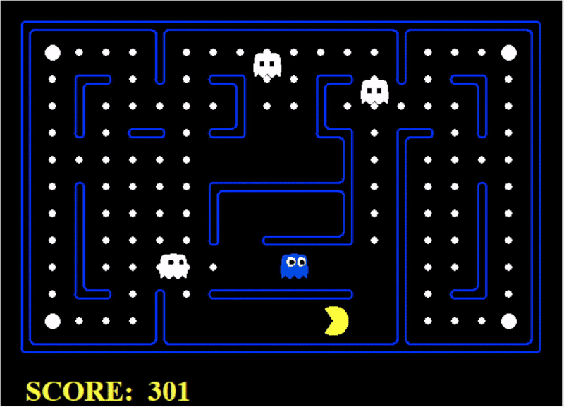

# Pac-Man AI Search and Decision Making

An AI search project developed for **FIT5047 Fundamentals of Artificial Intelligence** at Monash University using a course-provided Pac-Man environment.

The goal was to navigate mazes, collect food, and make decisions while responding to ghosts and using power capsules.

> The original coursework source code is kept private. This repository is a portfolio overview of the project.

## What I Implemented

- Built **A\*** search with Manhattan-distance heuristics for single-target and nearest-food navigation.
- Used **BFS** to compute maze-aware distances and construct routes for food collection.
- Developed a **hybrid agent** combining planned routes, reactive ghost avoidance, and adversarial search.
- Implemented **iterative-deepening Alpha-Beta search** with heuristic action ordering and time checks.
- Designed a **state evaluation function** considering food, capsules, ghost proximity, and scared-ghost opportunities.

## System Overview

Game State\
→ Threat Assessment and Target Selection\
→ Route Planning or Alpha-Beta Search\
→ Action Selection

## Technologies

*Python · A\* · BFS · Heuristic Search · Alpha-Beta Pruning · Game AI*

## Demo

Recorded from the original game interface.

## Possible Improvements

One extension I would like to explore is **maze-aware ghost distance estimation** to improve decisions around walls and narrow corridors.

---

The game engine and interface were provided with the coursework, based on the [UC Berkeley Pacman AI projects](http://ai.berkeley.edu).

**FIT5047 — Fundamentals of Artificial Intelligence**\
Monash University, 2026
